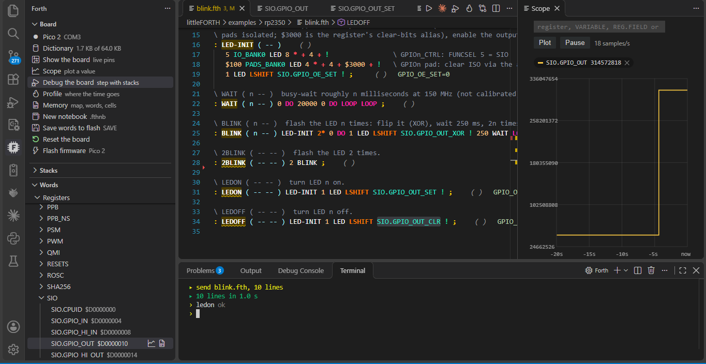

# littleFORTH

A small, native Forth for microcontrollers, with a VS Code extension for live,
interactive development and debugging.

Made for learning and experimenting: see the stack after every line, the machine code each word compiles to, and every register by its datasheet name. A way into Forth, ARM assembly and how a microcontroller really works.

**Beta:** RP2350, on the Raspberry Pi Pico 2 and Pico 2 W.

## Features

- **A Forth kernel** in under 8 KB of flash.
- **ANS / Forth 2012 CORE compliant:** see [Forth 2012 CORE tests](https://forth-standard.org/standard/testsuite) and John Hayes' 1995 suite for ANS Forth in [test/core.fr](test/core.fr).
- **Native-code compiler:** transforms word definitions to machine code on the chip.
- **Subroutine threading (STC) with inlining:** each word in a definition is compiled as a call (BL), but small primitives like `DUP` and `+` are copied in directly.
- **Dictionary:** new word definitions are held in a 64 KB dictionary in RAM. `SAVE` stores it in flash.
- **Assembler module:** write **CODE definitions** in native assembly blocks (between `CODE` and `END-CODE`).
- **Register names included:** generated from the chip's SVD file, so every register is there by its datasheet name (`UART0.UARTDR`, `IO_BANK0`), with nothing to load and no dictionary space used.
- **Interrupts in Forth:** `' TICK 0 IRQ!` and the handler runs, while the
  console stays free. A fault in your code prints an error and returns to the
  prompt.
- **Drivers in Forth:** for GPIO, timers, ADC, PWM, UART, SPI, I2C, the
  watchdog and more.
- **A VS Code extension:** shows what the chip is doing: the stack after
  every line as you type, live values beside the source, hot reload, inspect
  and decompile any word, a memory map, a scope, notebooks, and a debugger
  that steps word by word with the stack beside each word.

## Quick start guide

**You will need:**
- **VS Code**
- a **Raspberry Pi Pico 2** or **Pico 2 W**
- a **Raspberry Pi Debug Probe**

**What to do:**
1. Install **littleFORTH** from VS Code's Extensions view. Run *Forth: Work
   Without a Board* and type Forth straight away: the kernel also runs inside
   VS Code.
2. With a Pico 2 or Pico 2 W and a Raspberry Pi Debug Probe: wire the probe,
   flash from the extension, and blink an LED. [Getting started](docs/getting-started.md)
   takes you through it.
3. The console is on UART0 (GP0/GP1), not the Pico's USB port. A USB-serial adapter on GP0/GP1 also works, for the console only.

## Documentation

- [Getting started](docs/getting-started.md)
- [The extension](docs/extension.md)
- [Words](docs/words.md)
- [Drivers](lib/rp2350/drivers/README.md)
- [How it works](docs/architecture.md)
- [Building from source](docs/building.md)
- [Changes](CHANGELOG.md)

## Repository layout

| Folder | What is in it |
|---|---|
| [src/](src) | The kernel: interpreter, compiler, code generator, words |
| [board/](board) | One file per board: startup, clocks, console, linker script |
| [lib/](lib) | Forth libraries: RP2350 drivers, the Thumb-2 assembler, `SAVE` |
| [examples/](examples) | Example programs for the Pico 2 |
| [extension/](extension) | The VS Code extension |
| [test/](test) | Kernel tests, including the Hayes CORE suite |
| [tools/](tools) | Build, test and code-generation scripts |
| [docs/](docs) | Documentation |

**Where it starts:** on the Pico 2, `kmain()` in
[board/pico2.c](board/pico2.c) sets up the chip, then calls `kernel_init()`
and `quit()`, the outer interpreter, in [src/interp.c](src/interp.c). The
host build's `main()` is in [board/host.c](board/host.c).

## Help and ideas

Bug reports, questions and ideas are welcome in
[Issues](https://github.com/littleforth/littleFORTH/issues).

littleFORTH is free and made in spare time. If it is useful to you,
[buying me a coffee](https://ko-fi.com/littleforth) keeps it going.

## Licence

MIT (see [LICENSE](LICENSE)). Third-party files and their licences are listed
in [NOTICE](NOTICE).
